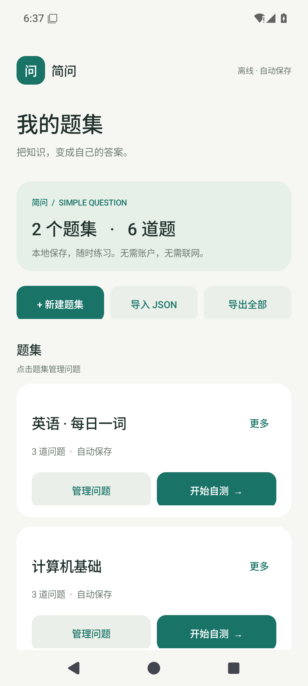
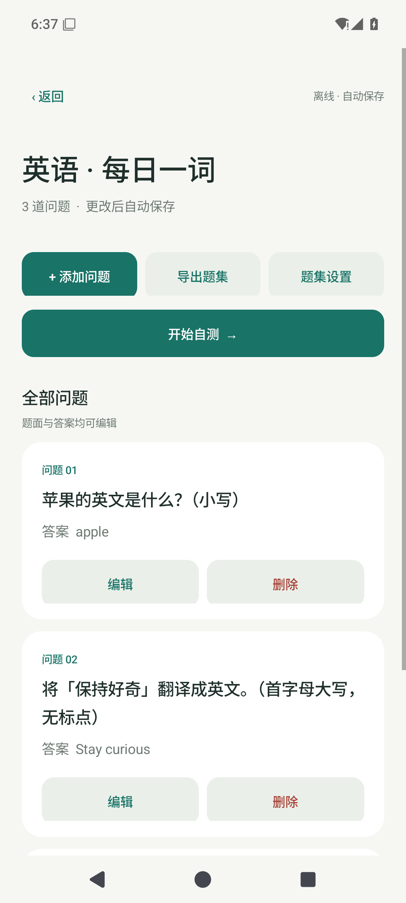
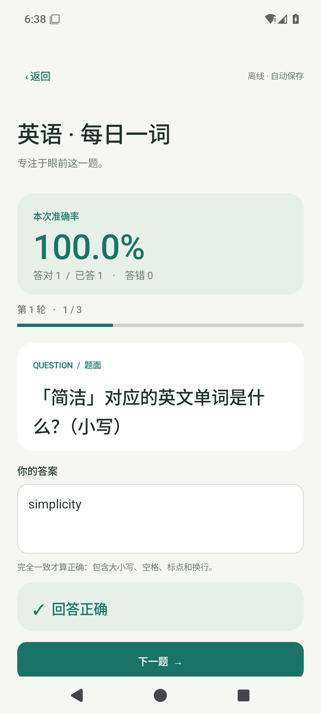

# 简问 · Simple Question

一个轻量、离线、界面简洁的 Android 问答自测应用。原生 Java 实现，无运行时第三方依赖，无账户、广告或联网权限。

## 安装

- 需要 Android 8.0（API 26）或更高版本。
- 下载本仓库 `releases/simple-question-1.0.0.apk`，或 GitHub Releases 中的同名安装包。
- 在手机上打开 APK，允许当前文件管理器安装未知来源应用后安装。
- 应用包名：`com.ggn.simplequestion`；显示名称：**简问**。

## 功能

- 新建、重命名、删除多个题集；添加、编辑、删除题目。
- 每题包含题面和标准答案，支持中文、多行文本。
- 导出单个题集或全部题集；通过 Android 系统文件选择器导入 UTF-8 JSON。
- 导入前确认内容数量，作为新题集追加，**不覆盖原数据**；同名题集分别保留。
- 每次保存使用本地原子文件写入，退出、重启或被系统回收后，已保存的题库仍然保留。
- 自测逐字精确判题：大小写、首尾空格、标点和换行都必须一致；不会自动 trim 或 Unicode 归一化。错误反馈提供空白字符可视化。
- 实时显示本次答对、答错、已答数量及准确率（答对数 ÷ 已提交数）；同题不能重复提交计分。
- 每轮随机遍历全部题目，轮内不重复，跨轮首尾也不相邻重复；可持续练习，主动结束时清零本次统计。
- 只有一道题时，回答后结束该次自测，不连续重复这道题；空题集不能开始自测。
- 自测题序、统计、提交状态和输入草稿会保存，可在重新进入应用后继续；旋转屏幕会恢复编辑对话框内未保存的内容。

清除应用数据或卸载会删除本地题库。请用 JSON 导出做备份；系统云备份和设备迁移已关闭。

## JSON 格式

完整示例见 `examples/questions.json`。一个文件可以含有一个或多个题集：

```json
{
  "schemaVersion": 1,
  "sets": [
    {
      "name": "英语单词",
      "questions": [
        { "prompt": "苹果的英文是什么？", "answer": "apple" },
        { "prompt": "将「保持好奇」翻译成英文。", "answer": "Stay curious" }
      ]
    }
  ]
}
```

`schemaVersion` 为数字 `1`。名称、题面和答案须为非空白字符串。导出会携带内部 `id`；导入不需要填写 `id`，每次导入都会生成新 ID。

限制：题集最多 500 个，全部题集合计最多 10,000 道题；名称最多 100 个 UTF-16 字符，题面和答案各最多 20,000 个 UTF-16 字符；导入文件及本地题库各最多 10 MiB。超过限制、错误编码或不符合结构的文件会被拒绝，已有数据不变。

## 构建

依赖 JDK 17、Android SDK Platform 35 和 SDK Build Tools 34.0.0。Gradle 8.9 Wrapper 已包含，首次构建需要下载构建依赖。

Windows PowerShell：

```powershell
$env:JAVA_HOME = '你的 JDK 17 目录'
$env:ANDROID_HOME = "$env:LOCALAPPDATA\Android\Sdk"
.\gradlew.bat testDebugUnitTest lintDebug assembleDebug
```

macOS / Linux：

```sh
export JAVA_HOME=/path/to/jdk17
export ANDROID_HOME=/path/to/android-sdk
bash gradlew testDebugUnitTest lintDebug assembleDebug
```

也可以直接用 Android Studio 打开项目，设置 SDK 路径后运行。Debug APK 位于 `app/build/outputs/apk/debug/app-debug.apk`。

### Release 签名

本次交付的 Release APK 已使用专用私钥签名。**签名私钥和密码不在 Git 仓库中。** 此电脑的签名资料位于用户目录 `.android/simple-question/`，请妥善备份；之后只有使用同一私钥签名的 APK 才能直接覆盖升级。

构建配置从 `~/.android/simple-question/signing.properties` 读取：

```properties
storeFile=C:/path/to/private/release.jks
storePassword=YOUR_STORE_PASSWORD
keyAlias=simple-question
keyPassword=YOUR_KEY_PASSWORD
```

```powershell
.\gradlew.bat assembleRelease
```

配置存在时生成已签名的 `app/build/outputs/apk/release/app-release.apk`；未配置时生成未签名包。GitHub Actions 只生成测试用 Debug APK，不使用或上传 Release 私钥。

## 验证

- 21 项 JUnit 测试：随机遍历、跨轮去重、精确判题、统计、状态恢复、JSON 往返与校验边界。
- Android Lint 检查。
- Android 15 / API 35 模拟器测试：本地持久化、写入中断保护、损坏文件保护、增删改、界面操作、自测统计、界面重建和进程重启恢复、系统文件选择器导出及再导入。

已启动 Android 模拟器时，可在 PowerShell 7 中运行完整设备冒烟测试（**会清空该模拟器中的简问数据，只允许模拟器**；文件选择器测试要求系统语言为英文）：

```powershell
.\scripts\device-smoke.ps1 -Serial emulator-5554
```

项目结构：`QuestionRepository` 负责原子持久化，`JsonCodec` 负责导入导出格式与限制，`QuizSession` 是可单独测试的出题及判题核心，`MainActivity` 负责原生界面。GitHub Actions 自动运行单元测试、Lint 和 Debug 构建。

## 界面预览

以下是安装本次签名 Release APK 后的 Android 15 模拟器截图，内容来自示例 JSON。

  
